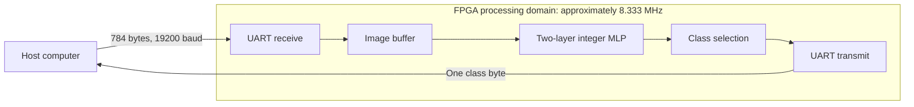

# Quantized MLP on Artix-7

I implemented the quantization-parameter and fixed-point functions for a neural-network RTL generator, integrated them into the course framework, and completed the Vivado flow and an FPGA board check.

The network is an **8-bit MNIST MLP with 784 → 30 → 10 neurons**, from Hardware for Neural Networks coursework at TU Darmstadt. The course supplied the framework, model and generation templates. This documentation-only showcase presents my implementation work, earlier functional results and a later timing-repair extension.

## My implementation

I completed the four generator parameter functions covering:

- Per-neuron scale and zero-point correction.
- Accumulator width.
- Fixed-point multiplier generation.
- Shift generation.

I integrated these functions into the course-provided RTL-generation framework. This work covered per-channel quantization parameters and fixed-point requantization. [Design notes](docs/design-notes.md) explain the hardware trade-offs; [scope and contributions](docs/scope-and-contributions.md) distinguishes my work, the course framework and later collaboration.

## Earlier functional results

These results precede the 31 October timing repair:

| Evaluation | Result | Scope |
| --- | --- | --- |
| Python model of the RTL's integer arithmetic | **95.26% on 10,000 MNIST test vectors** (9,526 correct) | Historical integer-equivalent evaluation |
| UART-based check on a Nexys A7-100T | **29 of 30 randomly selected samples correctly classified** | Small on-board functional sample |

The board test used the course-provided UART test flow. Its saved transcript records the 29/30 count but does not include an exact test date or bitstream identifier. These are earlier results; they are not new accuracy measurements or a board retest of the later repaired implementation.

## Later UART timing repair and FPGA results

An AI coding agent implemented the later UART/constraint timing repair and prepared its directed verification scripts. I reran the Vivado project, generated the bitstream and exported the results. This extension is separate from my original generator implementation and earlier board check.

The following diagram describes the repaired interface. UART reception/transmission, image storage, network registers, classification and display use one processing domain.

This is a high-level diagram drawn for this summary, not a circuit schematic or a copy of a lecture figure. The processing clock is derived from a 100 MHz board input by division by 12. The UART protocol is nominally **19,200 baud, 8N1**. The host sends one image and waits for its reply before sending another.

The following values are transcribed from my saved **31 October 2026** Vivado reports, targeting **`xc7a100tcsg324-1`** with **Vivado 2026.1**. Synthesis, routing and bitstream generation completed.

| Post-route resource | Used | Utilization |
| --- | ---: | ---: |
| LUTs | 49,062 | 77.38% |
| Flip-flops | 4,025 | 3.17% |
| DSPs | 40 | 16.67% |
| Block RAM tiles | 0 | 0.00% |
| Slices | 15,200 | 95.90% |

| Timing or routing metric | Recorded result |
| --- | ---: |
| Setup WNS | +8.109 ns |
| Hold WHS | +0.122 ns |
| TNS / THS | 0 / 0 ns |
| Failing setup / hold endpoints | 0 / 0 |
| Unclocked register pins | 0 |
| Unconstrained internal endpoints | 0 |
| Routing errors | 0 |

**These results establish internal timing closure under the applied constraints.** Two input ports and ten output ports still lack I/O delay constraints. Slice occupancy is high at 95.90%. The exported reports retain **121 ordinary DRC warnings** and **3,119 small-multiplier methodology warnings**. This is not a zero-warning build or complete external-interface timing signoff. **I have not retested the repaired implementation on a physical board.**

## Verification of the later implementation

- The existing parameter tests passed 4/4. A 16-example clocked HDL regression matched its saved prediction baseline; 14/16 predictions matched the fixture labels. This small fixture is not an accuracy benchmark.
- Saved repair logs report directed UART-wrapper tests and three full-network frames whose score bytes matched an unchanged reference instance. These are recorded simulation results, not a new full-dataset accuracy measurement.
- I reran synthesis and implementation in Vivado. The bitstream and original reports are not included in this showcase.

This is a documentation-only showcase. It does not provide the sources or fixtures needed to reproduce those tests or the FPGA build. [The structured result summary](results/implementation-summary.json) contains the same reported metrics and limits.
