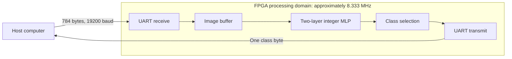

# Quantized MLP on Artix-7

I implemented the quantization-parameter and fixed-point functions for a neural-network RTL generator, integrated them into the course framework, and completed the Vivado flow and an earlier FPGA board test. This repository presents that work alongside the later AI-implemented UART timing repair.

The network is an **8-bit MNIST MLP with 784 → 30 → 10 neurons**. It comes from Hardware for Neural Networks coursework at TU Darmstadt. The course provided the framework, model and generation templates. This public repository contains newly written summaries and a schematic diagram; it does not contain the course implementation or completed solutions.

## Data path

This is a high-level diagram drawn for this summary, not a circuit schematic or a copy of a lecture figure. The processing clock is derived from a 100 MHz board input by division by 12. The UART protocol is nominally **19,200 baud, 8N1**. The host sends one image and waits for its reply before sending another.

## What I implemented

I completed the generator exercise: the parameter functions for per-neuron scale and zero-point correction, accumulator width, and the fixed-point multiplier and shift. I integrated these functions into the course-provided RTL-generation framework. This work covered per-channel quantization parameters and fixed-point requantization; it did not involve authoring the framework or training the supplied model from scratch.

An AI coding agent implemented the UART/constraint timing repair and prepared its directed verification scripts. I reran the actual Vivado project, generated the bitstream and exported the final results. AI also assisted with this documentation and diagram. I keep that contribution separate from the original course framework and the generator exercise. [Design notes](docs/design-notes.md) explain the trade-offs; [scope and contributions](docs/scope-and-contributions.md) records the boundaries.

## FPGA implementation results

These values are transcribed from my saved **31 October 2026** Vivado reports. The target was **`xc7a100tcsg324-1`**, using **Vivado 2026.1**. Synthesis, routing and bitstream generation completed.

| Post-route resource | Used | Utilization |
| --- | ---: | ---: |
| LUTs | 49,062 | 77.38% |
| Flip-flops | 4,025 | 3.17% |
| DSPs | 40 | 16.67% |
| Block RAM tiles | 0 | 0.00% |
| Slices | 15,200 | 95.90% |

| Timing or routing metric | Recorded result |
| --- | ---: |
| Setup WNS | +8.109 ns |
| Hold WHS | +0.122 ns |
| TNS / THS | 0 / 0 ns |
| Failing setup / hold endpoints | 0 / 0 |
| Unclocked register pins | 0 |
| Unconstrained internal endpoints | 0 |
| Routing errors | 0 |

**These results establish internal timing closure under the applied constraints.** Two input ports and ten output ports still lack I/O delay constraints. Slice occupancy is high at 95.90%. The exported reports retain **121 ordinary DRC warnings** and **3,119 small-multiplier methodology warnings**. This is not a zero-warning build or complete external-interface timing signoff. **I have not retested the repaired implementation on a physical board.**

## Verification scope

Earlier results, before the 31 October timing repair:

- **95.26% on 10,000 MNIST test vectors** in a Python model of the RTL's integer arithmetic (9,526 correct). This is the historical integer-equivalent result, not a new full-dataset measurement on the repaired FPGA build.
- **29 of 30 randomly selected samples correctly classified on a Nexys A7-100T**, using the course-provided UART test flow. This is a small on-board functional check, not an estimate of full-dataset model accuracy. The saved transcript records the 29/30 count but does not include an exact test date or bitstream identifier.

Checks associated with the recovery and timing repair:

- The existing parameter tests passed 4/4. A 16-example clocked HDL regression matched its saved prediction baseline; 14/16 predictions matched the fixture labels. This small fixture is not an accuracy benchmark.
- Saved repair logs report directed UART-wrapper tests and three full-network frames whose score bytes matched an unchanged reference instance. These are recorded simulation results, not a new full-dataset accuracy measurement.
- I reran synthesis and implementation in Vivado. The bitstream and original reports remain outside this public repository.

This is a documentation-only showcase. It does not provide the sources or fixtures needed to reproduce those tests or the FPGA build. [The structured result summary](results/implementation-summary.json) contains the same reported metrics and limits.
